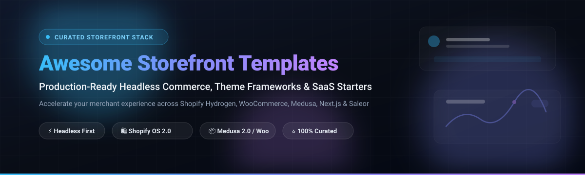

  

# 🛒 Awesome Storefront Templates & Headless Ecommerce Starters

**A curated index of top-tier SaaS storefront themes, open-source headless commerce starters, and component-rich ecommerce design frameworks.**

*Accelerate your online storefront launch across Shopify, Hydrogen, Next.js, WooCommerce, Medusa, and Saleor.*

---

## 📑 Table of Contents

- [📊 Sector Overview & Market Dynamics](#-sector-overview--market-dynamics)
- [🏢 SaaS & Hosted Commercial Storefront Platforms](#-saas--hosted-commercial-storefront-platforms)
- [🔓 Open-Source Storefront & Headless Starters](#-open-source-storefront--headless-starters)
  - [⭐ Ranked Open-Source Repositories](#-ranked-open-source-repositories)
  - [🔍 Ecosystem Architecture & Framework Highlights](#-ecosystem-architecture--framework-highlights)
- [🤝 How to Contribute](#-how-to-contribute)
- [💖 Support & Sponsorship](#-support--sponsorship)
- [📈 Star History](#-star-history)
- [⚖️ Disclaimer & Compliance](#️-disclaimer--compliance)

---

## 📊 Sector Overview & Market Dynamics

The global ecommerce software and theme template market is estimated at **$1.8B–$2.4B** within the wider $20B+ digital commerce platform ecosystem, expanding at a CAGR of ~13.5%. The market structure is **highly fragmented** across thousands of independent design studios, agency theme developers, and specialized marketplaces (e.g., Shopify Theme Store, ThemeForest, Woo Marketplace), although Shopify retains strong centralized governance over its proprietary commercial theme distribution channel.

---

## 🏢 SaaS & Hosted Commercial Storefront Platforms

Commercial theme platforms and established boutique studios build conversion-rate-optimized (CRO), enterprise-grade themes with dedicated warranty, automated version migration tools, and native app features.

> [!NOTE]  
> All premium themes listed on the official Shopify Theme Store offer an **unlimited free trial**: you can test, configure, and preview the full theme in development environments for free, paying the one-time license fee only upon publishing live to a custom domain.

| Studio / Platform | Valuation / Annual Revenue | Starting Price | Free Tier / Trial Details | Primary Focus & Capabilities |
| :--- | :--- | :--- | :--- | :--- |
| **[Shopify Themes](https://themes.shopify.com/)** | **~$209.56B** (Market Cap) / **$11.56B** (FY2025 Rev) | $100 (one-time) | Free forever for default themes (Dawn, Refresh, etc.); Unlimited dev trial for paid themes until live publication | Official curated ecosystem featuring strict OS 2.0 performance audits, accessibility standards, and lifetime compatibility updates. |
| **[Out of the Sandbox](https://outofthesandbox.com/)** | **~$25M - $35M** (Acquired studio est.) | $240 (one-time) | 14-day money-back guarantee on direct storefront; Unlimited preview & sandbox testing in Shopify Admin | Industry benchmark for high-speed performance (*Turbo*) and visual drag-and-drop customization (*Flex*). |
| **[Pixel Union](https://pixelunion.net/)** | **~$20M - $30M** (WeCommerce / Tiny portfolio) | $250 (one-time) | Unlimited free staging & development preview; pay only when publishing live to custom domain | Clean editorial aesthetics tailored for design-conscious lifestyle, boutique apparel, and direct-to-consumer (DTC) brands. |
| **[Archetype Themes](https://archetypethemes.co/)** | **~$15M - $25M** (Est. annual run-rate) | $380 (one-time) | Unlimited free trial on development & partner stores until live store launch | Category leader for conversion-centric high-catalog stores (*Impulse*, *Expanse*, *Motion*) with advanced faceted search and promotional tiles. |
| **[Clean Canvas](https://cleancanvas.co.uk/)** | **~$10M - $18M** (Est. annual run-rate) | $400 (one-time) | Unlimited development store customization trial; pay only upon live production release | High-volume retail and enterprise inventory layouts (*Symmetry*, *Enterprise*, *Showcase*) with deep product discovery filtering. |
| **[Presidio Creative](https://presidiocreative.com/)** | **~$8M - $15M** (Est. annual run-rate) | $300 (one-time) | Unlimited sandbox trial in Shopify Admin with complete feature preview; pay when going live | High-end visual storytelling and media-rich layouts (*Palo Alto*, *Broadcast*) built for modern fast-growing luxury DTC brands. |
| **[Maestrooo](https://maestrooo.com/)** | **~$8M - $14M** (Est. annual run-rate) | $380 (one-time) | Unlimited free dev trial on store backends until domain publishing | Prestigious minimalist luxury and editorial layouts (*Prestige*, *Impact*, *Warehouse*) standard among global fashion labels. |
| **[Safe As Milk](https://safeasmilk.co/)** | **~$5M - $10M** (Est. annual run-rate) | $380 (one-time) | Unlimited dev trial until store publication with full section configuration | Highly rated modular layouts (*Venue*) crafted specifically for multi-location brick-and-mortar brands and hybrid merchants. |
| **[Troop Themes](https://troopthemes.com/)** | **~$5M - $10M** (Est. annual run-rate) | $380 (one-time) | Unlimited development environment testing and design trial; pay only on live activation | Aesthetic-forward, typography-driven Shopify themes (*Beyond*, *Blockshop*, *Maker*) optimized for visual creators and boutique brands. |
| **[Fluorescent](https://fluorescent.co/)** | **~$4M - $8M** (Est. annual run-rate) | $380 (one-time) | Unlimited staging and draft trial before publishing to production store | Contemporary, editorial luxury storefronts (*Stiletto*, *Spark*) engineered for brand narrative and conversion velocity. |
| **[We Are Underground](https://weareunderground.com/)** | **~$4M - $8M** (Est. annual run-rate) | $250 (one-time) | Unlimited theme configuration & testing trial until live domain release | Versatile, time-tested merchant storefronts (*Testament*, *Icon*, *Foodie*) designed for flexible product showcases. |

---

## 🔓 Open-Source Storefront & Headless Starters

Open-source storefront templates provide foundational codebases for headless commerce architectures, custom block themes, and composable setups across React, Next.js, Remix, Vue, and WordPress.

### ⭐ Ranked Open-Source Repositories

*Repositories are sorted in descending order by GitHub stargazers count:*

1. **[Vercel Commerce](https://github.com/vercel/commerce)**  
     
   📦 *Next.js 15, React 19, Tailwind CSS, TypeScript*  
   The gold standard all-in-one headless commerce template featuring multi-provider adapters (Shopify, BigCommerce, Saleor, Medusa, Ordercloud). Delivers sub-second page transitions, edge caching, and server actions.

2. **[Vue Storefront](https://github.com/vuestorefront/vue-storefront)**  
     
   📦 *Vue.js, Nuxt, Composable Frontends*  
   Leading Frontend-as-a-Service framework connecting any backend (commercetools, Magento, SAP, BigCommerce) with custom modular Vue and Nuxt storefront architectures.

3. **[Shopify Dawn](https://github.com/Shopify/dawn)**  
     
   📦 *Liquid, HTML5, Vanilla JavaScript, CSS*  
   Shopify's official open-source reference theme for Online Store 2.0. Minimal JavaScript footprint, ultra-performant scoreboards, and the base archetype for all modern Shopify Liquid themes.

4. **[Medusa Next.js Starter](https://github.com/medusajs/nextjs-starter-medusa)**  
     
   📦 *Next.js 15, Medusa 2.0, Tailwind CSS, Stripe*  
   Official Medusa 2.0 headless storefront featuring out-of-the-box product search, customer account dashboards, Stripe checkout flows, cart management, and regional currency switching.

5. **[Shopify Hydrogen](https://github.com/Shopify/hydrogen)**  
     
   📦 *Remix, React, Vite, GraphQL Storefront API*  
   Shopify’s official React-based headless stack featuring Oxygen deployment configurations, skeleton starter layouts, GraphQL generation, and Subrequest caching.

6. **[Saleor Storefront](https://github.com/saleor/storefront)**  
     
   📦 *Next.js 14/15 App Router, React 18/19, TypeScript, GraphQL*  
   Official high-performance headless storefront boilerplate built natively for Saleor’s GraphQL commerce engine, including checkout, catalog filters, and authentication.

7. **[WooCommerce Storefront Core](https://github.com/woocommerce/storefront)**  
     
   📦 *PHP, WordPress Theme Engine, WooCommerce Core*  
   The foundational classic WooCommerce theme engineered and maintained by Automattic/WooCommerce core developers, designed for rock-solid stability and plugin extensibility.

8. **[Next.js Shopify Storefront (VienDinhCom)](https://github.com/VienDinhCom/next-shopify-storefront)**  
     
   📦 *Next.js, TypeScript, Tailwind CSS, Headless UI, Hydrogen React*  
   Popular independent reference implementation for building modern, responsive, and decoupled Shopify storefronts using the Storefront GraphQL API.

9. **[Medusa B2B Starter](https://github.com/medusajs/b2b-starter-medusa)**  
     
   📦 *Next.js, Medusa B2B, Tailwind CSS*  
   Tailored wholesale and B2B ecommerce starter supporting customer company hierarchies, role-based spending limits, price lists, invoice requests, and custom bulk purchasing.

10. **[Bootstrap Shopify Theme (VienDinhCom)](https://github.com/VienDinhCom/bootstrap-shopify-theme)**  
      
    📦 *Shopify Liquid, Bootstrap 5, Sass, Webpack, ESNext*  
    Fully responsive traditional Shopify Liquid theme built on Twitter Bootstrap, ideal for developers migrating classic web designs into Shopify.

11. **[Strapi Ecommerce Template](https://github.com/strapi/strapi-template-ecommerce)**  
      
    📦 *Strapi CMS, Next.js / React Frontend, Stripe*  
    Headless content-driven storefront boilerplate integrating Strapi headless CMS with custom frontend checkouts, digital goods delivery, and product catalogs.

12. **[ada ÉLAN Fashion Theme](https://github.com/ozgursagiroglu/shopify-hydrogen-fashion-theme)**  
      
    📦 *Shopify Hydrogen, React Router 7, Tailwind 4, TypeScript*  
    Production-ready Shopify Hydrogen storefront theme featuring full i18n with **RTL support** (Arabic/Hebrew), WCAG AA compliance, structured SEO schema, and a custom demo metaobject seeding CLI.

13. **[Aviendha FSE Theme](https://github.com/imagewize/aviendha)**  
      
    📦 *WordPress Full Site Editing (FSE), WooCommerce Blocks, theme.json*  
    Lightweight, clean Gutenberg block starter theme for WooCommerce developers seeking a strict `theme.json` design token foundation without heavy runtime dependencies.

14. **[Medusa Starter Monorepo (Next.js 15 + Medusa 2.x)](https://github.com/rawals-info/store)**  
      
    📦 *Turborepo, Medusa 2.x, Next.js 15 App Router, Tailwind CSS*  
    Complete full-stack monorepo scaffolding an enterprise-style setup with unified backend management, shared frontend components, and preconfigured automated seeding.

15. **[Medusa Shop Next.js 15 Starter](https://github.com/MichaelYangjson/medusa-shop)**  
      
    📦 *Next.js 15, Medusa V2, Server Components, Server Actions*  
    Modern decoupled frontend template built on Next.js 15 App Router with instant pre-rendering, streamlined Stripe checkout, and account profile management.

---

### 🔍 Ecosystem Architecture & Framework Highlights

When choosing a foundation for custom storefront development:
* 🌐 **Shopify Hydrogen & Oxygen (React / Remix):** Ideal for merchants scaling on Shopify who need bespoke frontend user experiences while retaining Shopify’s secure hosted checkout. Start with the [Hydrogen Core Skeleton](https://github.com/Shopify/hydrogen) or reference [ada ÉLAN](https://github.com/ozgursagiroglu/shopify-hydrogen-fashion-theme).
* 🛍️ **Shopify Liquid OS 2.0:** Use [Shopify Dawn](https://github.com/Shopify/dawn) as the reference implementation for zero-dependency native theme development.
* 📦 **Medusa.js 2.0:** Perfect for developers wanting 100% control over both backend microservices and headless frontends. Use [Medusa Next.js Starter](https://github.com/medusajs/nextjs-starter-medusa) or [B2B Starter](https://github.com/medusajs/b2b-starter-medusa).
* ⚡ **Saleor GraphQL:** High-throughput Python/Django backend paired with [Saleor Storefront](https://github.com/saleor/storefront) for Next.js App Router applications.
* 🔌 **WooCommerce & WordPress FSE:** For WordPress block-editor stores, check out [WooCommerce Purple](https://github.com/woocommerce/woocommerce/tree/trunk/plugins/woocommerce/src/Themes/Purple) (inside core monorepo) or lean foundations like [Aviendha](https://github.com/imagewize/aviendha).

---

## 🤝 How to Contribute

We welcome open-source contributions, updated theme additions, and performance benchmark corrections! 🚀

1. 🍴 **Fork** the repository.
2. 🌿 Create your feature branch (`git checkout -b feature/add-new-storefront`).
3. 📝 Edit `README.md` following the tabular or badge-ranked formatting standards.
4. 🔍 Ensure all Stars_Counts, official links, and pricing details are verified.
5. 📤 Commit your changes (`git commit -m 'feat: add new headless storefront starter'`).
6. 🚀 Push to branch (`git push origin feature/add-new-storefront`).
7. 📬 Submit a **Pull Request** detailing your additions.

---

## 💖 Support & Sponsorship

Thank you so much for exploring this curated repository! If you found this storefront resource collection helpful, please consider supporting the project:

- ⭐ **Star** this repository to help other merchants and developers discover it.
- 🍴 **Fork** and contribute additions or updates.
- 📢 **Share** it with your developer networks, ecommerce agencies, and fellow builders.
- ☕ **Buy me a coffee / Sponsor**: If this project helped save you hours of development or evaluation time, you can support ongoing maintenance via the [GitHub Sponsors Dashboard](https://github.com/sponsors/ishandutta2007).

---

## 📈 Star History

---

## ⚖️ Disclaimer & Compliance

- This repository is a **community-maintained curated list** provided for educational and evaluation purposes.
- All commercial trademarks, brand names, and studio logos are the property of their respective owners (Shopify, Automattic, Vercel, Medusa, Saleor).
- Storefront templates handling real-world transactions and customer personal data must comply with PCI-DSS requirements, regional privacy laws (GDPR, CCPA), and platform security practices.
- Double-check open-source licenses before using code in commercial products (MIT, GPLv2, Apache 2.0, or proprietary).
